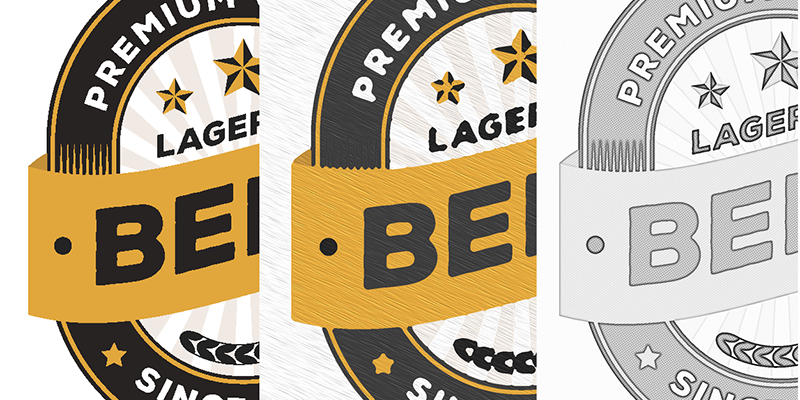

# Apex Sampled Image Example

C++ and C# examples of applying artistic effects to document pages with
Mako 9.1's Apex GPU renderer. Both projects use the same fragment shaders
and expose the same command-line option names and aliases.

The example demonstrates **sampled-image post-processing**: a shader can read
neighbouring pixels in the rendered image, rather than just the current pixel
available through a subpass input attachment. Apex supplies overlapping tiles
so neighbourhood operations can continue across tile boundaries.



In this example you can see the PDF before rendering (left), the painterly effect that simulates an oil painting (middle) and a pencil-sketch rendition (right).

## Effects

| `--art` | Result |
|---|---|
| `none` | Render the original page without an artistic shader; the default. |
| `oil` | Local histogram colour grouping, feature-following bristle relief and directional lighting. |
| `pencil` | Grayscale contours, tonal shading, cross-hatching and paper grain. |

Oil painting groups neighbourhood samples by luminance and uses the average
colour of the dominant group. Its relief follows local image structure using
a smoothed RGB structure tensor, with a manual direction as a fallback. The
effect approximates an oil-painted surface; it is not an implementation of
Photoshop's proprietary filter.

Pencil sketch combines a Gaussian neighbourhood blur with a grayscale
colour-dodge operation and central-difference outlines. Tonal shading,
cross-hatching and paper grain can be adjusted independently.

## Solution layout

```text
ApexSampledImageExample.sln
ApexSampledImageExample/          C++ application; cxxopts command-line parser
ApexSampledImageExample.csharp/   C# application; System.CommandLine parser
Shaders/                         Shared GLSL sources and compiled SPIR-V files
TestFiles/                       Sample input, including BeerLabels.pdf
LocalPackages/                   Local Mako NuGet package feed
NuGet.config                     Adds LocalPackages to the NuGet sources
```

The [C# project README](ApexSampledImageExample.csharp/README.md) contains
additional implementation and verification notes.

## Requirements

- Windows x64 and a Vulkan-capable GPU with a suitable graphics driver.
- Visual Studio with the Desktop development with C++ workload, the MSVC
  **v143** toolset and Windows SDK to build the C++ project. Its x64
  configurations use C++20.
- The **.NET 10 SDK** to build the C# project.
- Access to the Mako packages referenced below, with the features/licensing
  required by your Mako distribution.
- The Vulkan SDK's `glslc` tool if you want to edit and recompile the shaders.
  Existing `.spv` binaries are supplied, so shader compilation is not required
  for an ordinary build.

Current package references:

| Project | Package | Version |
|---|---|---|
| C++ | `MakoCore.OEM.Apex.Win-x64.VS2022.Static` | `9.1.0.78` |
| C# | `MakoCore.OEM.Net.Apex.Windows` | `9.1.0.103` |
| C# | `System.CommandLine` | `2.0.12` |

The C++ project includes `cxxopts.hpp`. Mako packages are supplied through
`LocalPackages`; System.CommandLine can be restored from nuget.org. If you
update the C++ Mako package, update its NuGet references/imports together.

## Build

### Visual Studio

1. Open `ApexSampledImageExample.sln`.
2. Restore NuGet packages.
3. Select **Debug | x64** or **Release | x64** and build the solution.
4. Choose either project as the startup project.

Use x64 even though the solution also contains x86 configurations: the
referenced Mako packages and C# platform target are x64.

### Command line

Run from the solution directory. For C++, use a Visual Studio Developer
PowerShell with MSBuild and the NuGet CLI available:

```powershell
nuget restore .\ApexSampledImageExample\packages.config -PackagesDirectory .\packages -Source .\LocalPackages
dotnet restore .\ApexSampledImageExample.csharp --source .\LocalPackages --source https://api.nuget.org/v3/index.json
msbuild .\ApexSampledImageExample.sln /p:Configuration=Release /p:Platform=x64
```

To build only C#:

```powershell
dotnet build .\ApexSampledImageExample.csharp -c Release
```

## Run

Both applications accept:

```text
<application> <input> [<output>] [options]
<application> --infile <input> --outfile <output> [options]
```

### C++

The current C++ shader path is `..\..\Shaders`, relative to the **working
directory**. Run from `x64\Release` or `x64\Debug`, or set the Visual Studio
debugging working directory to the corresponding output directory:

```powershell
Push-Location .\x64\Release
.\ApexSampledImageExample.exe ..\..\TestFiles\BeerLabels.pdf "..\..\renders\oil_%u.png" --art oil
.\ApexSampledImageExample.exe ..\..\TestFiles\BeerLabels.pdf "..\..\renders\pencil_%u.png" --art pencil
.\ApexSampledImageExample.exe --help
Pop-Location
```

### C#

C# copies the shared shader binaries into a `Shaders` directory beside the
executable and locates them relative to the executable. It can run from any
working directory; input/output paths remain relative to the working directory.
From the solution directory:

```powershell
dotnet run --project .\ApexSampledImageExample.csharp -c Release -- .\TestFiles\BeerLabels.pdf "renders\oil_%u.png" --art oil
dotnet run --project .\ApexSampledImageExample.csharp -c Release -- .\TestFiles\BeerLabels.pdf "renders\pencil_%u.png" --art pencil
dotnet run --project .\ApexSampledImageExample.csharp -c Release -- --help
```

### Files and page selection

Input format is selected by extension: `.pdf`, `.xps`, `.oxps`, `.ps`, `.eps`,
`.pcl` (PCL5) or `.pxl` (PCLXL). Output supports `.png`, `.jpg`/`.jpeg`,
`.tif`/`.tiff` and `.pdf`, subject to the encoder's colour-space/depth support.
PDF output is a **separate rasterized PDF for each selected page**.

If no output is supplied, the name is `<input-stem>_%u.tif` in the working
directory. `%u` is replaced by the original one-based page number; `%03u`
adds zero padding. Use `%%` for a literal percent sign. Parent output
directories are created automatically. Include a page placeholder for
multi-page output: a literal filename is overwritten for each selected page.

`--pages` counts pages across all documents in the input assembly. Examples:

| Selection | Meaning |
|---|---|
| `--pages 1` | First page only |
| `--pages "1-3,8"` | Pages 1 through 3 and page 8 |
| `--pages "5-"` | Page 5 to the end |
| `--pages "-3"` | Pages 1 through 3 |

Reversed ranges are accepted. Overlapping ranges do not duplicate output.

## Command-line controls

The defaults below describe the current source. Run `--help` for the options
in the executable you built.

### General and rendering

| Option | Alias | Default | Purpose |
|---|---|---|---|
| `--infile` | | Required | Input path; also accepted positionally. |
| `--outfile` | | `<input-stem>_%u.tif` | Output path/template; also accepted positionally. |
| `--pages` | `-p` | `1-` | Comma-separated page ranges. |
| `--art` | | `none` | `none`, `oil` or `pencil`. |
| `--resolution` | `-d` | `150` | DPI; use `300,600` for separate horizontal/vertical values. |
| `--bpc` | `-b` | `8` | Output bits per component: 8 or 16. |
| `--overprintpreview` | `-v` | `false` | Merge spot colours for overprint preview. |
| `--aafactor` | `-i` | `1` | Anti-alias factor, 1–4. |
| `--bigtiff` | `-B` | `false` | Use BigTIFF for TIFF output. |
| `--sixteen` | `-s` | `false` | Use 16-bit internal rendering. |
| `--renderspace` | `-r` | `rgb` | Process space: `gray`, `rgb` or `cmyk`. |
| `--renderprofile` | `-R` | Unset | Rendering ICC profile path. |
| `--finalspace` | `-f` | Render space | Final space: `gray`, `rgb` or `cmyk`. |
| `--finalprofile` | `-F` | Unset | Final ICC profile, including compatible device links. |
| `--ocgevent` | `-O` | `print` | Optional-content event: `view`, `print` or `export`. |
| `--gputhreads` | `-g` | `1` | Renderer workers per GPU. |
| `--useallgpus` | `-G` | `false` | Distribute pages across available GPUs. |
| `--exclude` | `-x` | `true` | Exclude integrated GPUs when using all GPUs. |
| `--dump` | `-U` | `false` | Print effective rendering settings. |
| `--help` | `-h` | | Show usage. |

Boolean switches enable an option when present. Use an explicit value such
as `--exclude=false` to disable an option that defaults to true. Short aliases
are case-sensitive: for example, `-r` and `-R` have different meanings.

Some rendering controls are currently only parsed by C++; see
[implementation differences](#implementation-differences) below.

### Oil painting

These options apply when `--art oil` is selected. Angles are in degrees;
spatial controls are measured in rendered pixels.

| Option | Default | Purpose |
|---|---|---|
| `--op-radius` | `4` | Histogram neighbourhood radius; clamped to 0–64. |
| `--op-bins` | `16` | Luminance groups; clamped to 2–32. |
| `--op-strength` | `1` | Blend between original and painted output, 0–1. |
| `--op-centre-weight` | `0` | Favour nearby samples; try 0–3 to retain detail. |
| `--op-bristle-spacing` | `4` | Bristle spacing; minimum 2 pixels. |
| `--op-stroke-length` | `80` | Scale of variation along strokes. |
| `--op-stroke-angle` | `25` | Manual/fallback stroke direction. |
| `--op-curvature` | `3` | Lateral bending for manual relief. |
| `--op-relief-depth` | `0.8` | Paint height; zero disables relief. |
| `--op-light-strength` | `0.65` | Relief lighting intensity, 0–1. |
| `--op-light-angle` | `135` | Light direction. |
| `--op-light-elevation` | `45` | Light elevation; clamped to 5–85 degrees. |
| `--op-shine` | `0.25` | Highlight strength, 0–1. |
| `--op-feature-follow` | `1` | Blend from manual relief (0) to guided relief (1). |
| `--op-direction` | `4` | Direction smoothing radius; clamped to 1–8 pixels. |
| `--op-feature` | `0.03` | Feature contrast; lower values follow weaker features. |

For broader daubs, try `--op-radius 12 --op-bins 8`. For more pronounced
relief, try `--op-relief-depth 1.5 --op-shine 0.5`. Set
`--op-feature-follow 0` to use the manual stroke direction throughout.

The guided relief uses a local tangent, rather than tracing complete curved
strokes. Its sampled stroke length is capped at 16 times the bristle spacing
to keep the procedural texture sufficiently sampled. Feature following adds
substantial neighbourhood sampling, so larger direction radii cost more.

### Pencil sketch

These options apply when `--art pencil` is selected.

| Option | Default | Purpose |
|---|---|---|
| `--ps-blur-radius` | `8` | Neighbourhood radius; clamped to 1–32 pixels. |
| `--ps-blur-sigma` | `4` | Gaussian smoothing scale in pixels. |
| `--ps-line-strength` | `1.4` | Contour darkness; clamped to 0–4. |
| `--ps-tone-strength` | `0.15` | Continuous graphite shading, 0–1. |
| `--ps-hatch-strength` | `0.35` | Cross-hatching intensity, 0–1. |
| `--ps-hatch-spacing` | `6` | Hatch spacing; minimum 3 pixels. |
| `--ps-hatch-angle` | `-35` | Hatch direction in degrees. |
| `--ps-paper-strength` | `0.025` | Paper grain; clamped to 0–0.2. |

For a clean outline drawing, use:

```text
--art pencil --ps-tone-strength 0 --ps-hatch-strength 0 --ps-paper-strength 0
```

Spatial settings are resolution-dependent: the same pixel radius produces
smaller marks on a page rendered at higher DPI. Increase radii and texture
spacing when you want to preserve the physical size of the effect.

## Shader development and tile overlap

Recompile edited GLSL from the solution directory using the Vulkan SDK:

```powershell
glslc .\Shaders\oil_paint.frag -o .\Shaders\oil_paint.spv
glslc .\Shaders\pencil_sketch.frag -o .\Shaders\pencil_sketch.spv
```

Rebuild C# after updating the binaries so the new files are copied beside
the executable. C++ reads the shared binaries directly using its relative
shader path.

Both effects are opaque RGB-to-RGB fragment shaders. They use `sampler2D`
and `texelFetch()` for neighbourhood reads, passed to Apex through
[`CCustomColorTexturePostProcessSpec`](https://api.hybridhelix.com/mako/class_jaws_mako_1_1_c_custom_color_texture_post_process_spec.html).
Optional final colour conversion runs after the artistic effect.

The `_extend` argument requests overlapping pixels around each tile. Its
current maximum is 64 pixels. The application calculates it from the controls:

- Oil: the histogram radius, or the direction smoothing radius plus two
  pixels when guided relief is active, whichever is larger.
- Pencil: the blur radius, clamped to 1–32 pixels.

Oil supplies **72 bytes** of user push constants; pencil supplies **40 bytes**.
Apex appends the signed `tileX` and `tileY` values after those bytes. The
shaders use tile-local coordinates for texture reads and full-image coordinates
for page-edge clamping, bristle texture, hatching and grain. This keeps the
procedural patterns continuous across tiles.

If you add a control, update the GLSL push-constant declaration and both host
structures/serializers together. Do not put Apex's appended tile offsets into
the user-supplied buffer. Revisit `_extend` if you increase the sampling reach.

## Implementation differences

Both projects share the shaders, effect controls and page-selection behaviour,
but their current host implementations differ:

| Area | C++ | C# |
|---|---|---|
| Shader location | Relative to the working directory: `..\..\Shaders`. | Copied beside the executable and resolved from its directory. |
| Output depth | Writers currently use 8 bits per component, regardless of `--bpc`. | Applies `--bpc`; rejects 16-bit JPEG output. |
| AA/internal depth | Parses `--aafactor` and `--sixteen`, but leaves render-spec defaults. | Applies both controls. |
| TIFF/overprint/OCG | Parses the corresponding options, but the main loop does not apply them. | Applies BigTIFF, spot merging and the selected OCG event. |
| GPU scheduling | Single renderer and sequential page loop; GPU scheduling flags are parsed. | Supports multiple renderer workers and GPU selection. |
| Non-square DPI | Uses both values for pixel dimensions, but writes horizontal DPI for both metadata values. | Preserves both DPI values in image metadata. |
| Render-spec dump | Parses `--dump` without printing a specification. | Prints effective settings. |
| Colour handling | Keep artistic examples at the default RGB render space; the main loop forces RGB while the post-process specification uses the parsed space. | Keeps the artistic post-process in RGB and sizes buffers for final space/depth. |
| Profile validation | Uses a profile when its path exists; otherwise keeps the selected device space. | Reports a missing profile path as an error. |

For comparable results, start with RGB, 8-bit output, square DPI and the same
effect settings. Existing executables can have older defaults than the source;
rebuild or pass controls explicitly when comparing outputs. Sample PNG output
has been verified pixel-for-pixel against C++ for all three effects with
identical settings.
